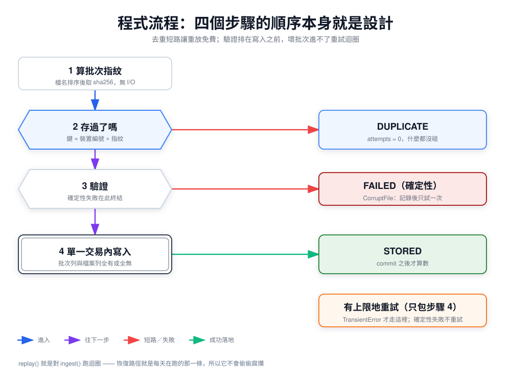
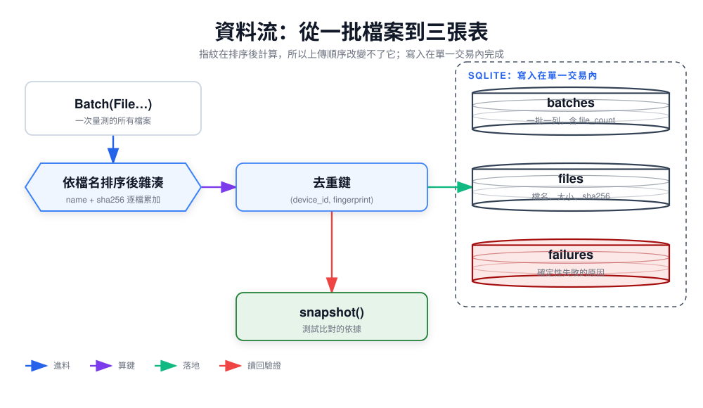
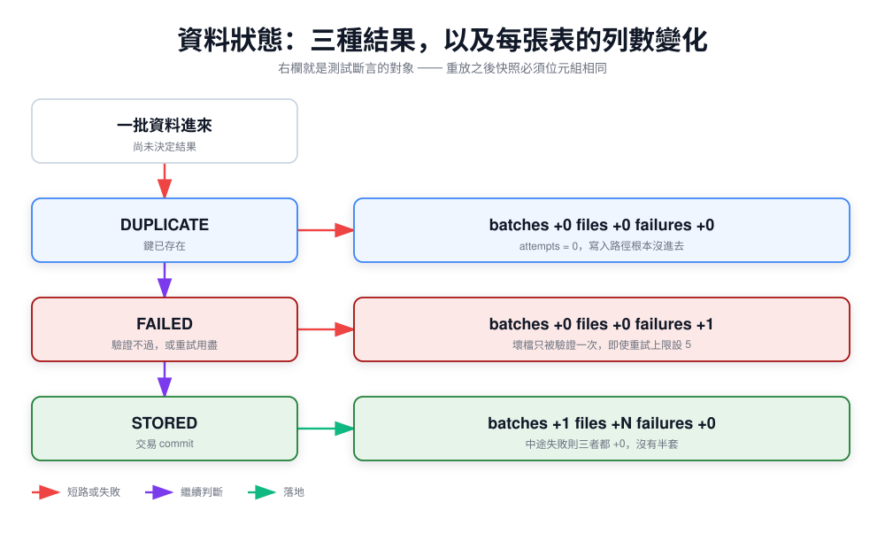
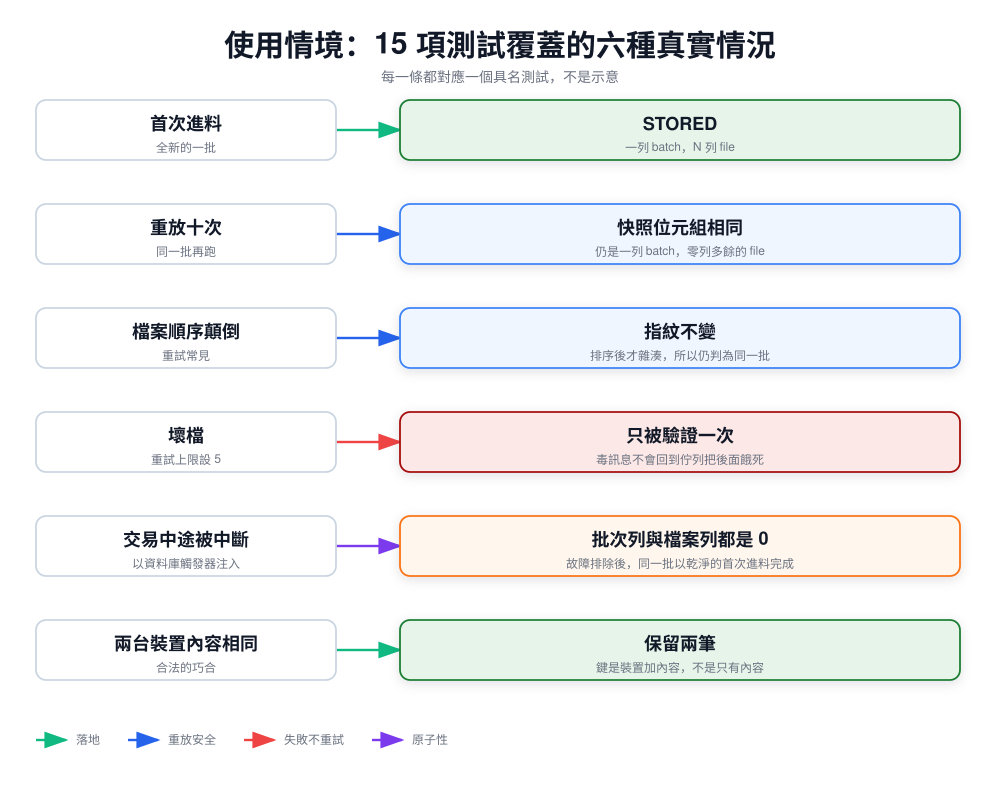

*[English](architecture.md) ｜ 繁體中文*

# 架構 —— 四個視圖

[`design.zh-TW.md`](design.zh-TW.md) 講的是**為什麼**重放安全勝過追求一次成功。這一頁講的是**程式實際做了什麼**，分四個視圖。

圖由 [`src/`](src) 裡的 JSON 產生；要改請改 JSON 重算，不要手改 SVG。

---

## 1. 程式流程



四個步驟的順序本身就是設計。第 1、2 步讓重放幾乎免費：指紋很便宜，而去重檢查在任何 I/O 之前就短路，所以重複進料回報的 `attempts` 是 0。

第 3 步排在第 4 步之前，是為了讓已知的壞批次進不了重試迴圈。**只有第 4 步外面包重試，而且只有 `TransientError` 會走到那裡**——`CorruptFile` 記錄一次之後永不再試。

對應原始碼：[`ingest.py`](../src/idemingest/ingest.py)

## 2. 資料流



指紋是對 `(檔名, sha256)` 這些配對**依檔名排序後**計算的，所以上傳順序改變不了它。重試經常會改變順序，少了這個排序，同樣的位元組會落地兩次。

去重鍵是 `(裝置編號, 指紋)`，不是只有指紋。兩台機器可能合法地產生位元組完全相同的讀數，兩筆都必須保留。

`snapshot()` 是為測試而存在的：重放等價是靠比對兩份快照來斷言的，所以儲存層需要一個確定性的完整讀取。

對應原始碼：[`model.py`](../src/idemingest/model.py)、[`store.py`](../src/idemingest/store.py)

## 3. 資料狀態



三種結果，而右欄就是測試斷言的對象——每種結果之後各張表的列數變化。

**最後一列值得讀兩次**：一批資料寫到一半失敗，三張表全部 `+0`。不是半批，也不是留下一個孤兒的批次列。這才是讓重試「安全」而不只是「看起來冪等」的原因。

對應原始碼：[`model.py`](../src/idemingest/model.py)、[`store.py`](../src/idemingest/store.py)

## 4. 使用情境



15 項測試覆蓋的六種情況。每一條都對應一個具名測試，不是示意：

```bash
uv run --with pytest pytest -q -k "replay or corrupt or abort"
```

對應原始碼：[`tests/`](../tests)

---

| 視圖 | 由哪些測試釘住 |
|---|---|
| 程式流程 | `test_idempotency.py`、`test_failure_classification.py` |
| 資料流 | `test_file_order_does_not_change_fingerprint`、`test_same_content_from_two_devices_is_two_batches` |
| 資料狀態 | `test_atomicity.py` |
| 使用情境 | 三個測試檔全部 |
