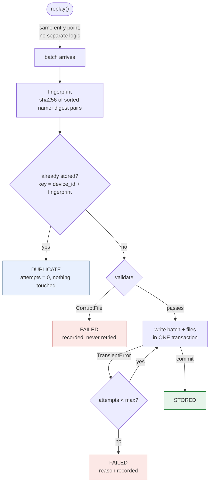
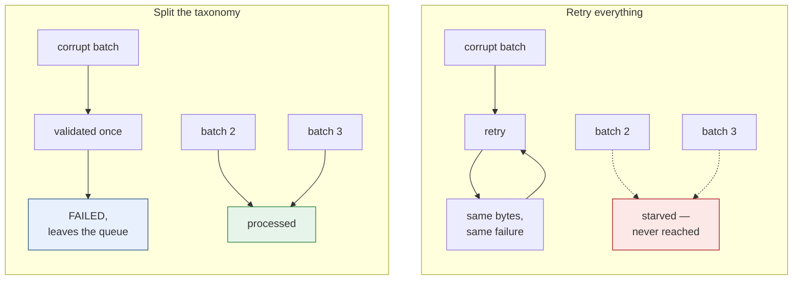

*English ｜ [繁體中文](design.zh-TW.md)*

# Design notes

Two diagrams for the two decisions the README argues for.

---

## 1. The dedup key, and why recovery is not a separate path

A batch is fingerprinted before anything else happens. If that fingerprint has
been seen for that device, the whole write path is skipped — no I/O, no
transaction, `attempts == 0`.

`replay()` does not have its own logic. It re-enters this same flow, which is
why the recovery path cannot rot: it is the path that runs every day.

Two details the diagram encodes:

- **The fingerprint sorts files by name before hashing**, so upload order cannot
  change it. Retries routinely reorder.
- **The key is `(device, content)`, not content alone.** Two machines can
  legitimately produce byte-identical readings, and both must be kept.

---

## 2. Why deterministic failures are never retried

Retrying a failure that cannot succeed is how an ingestion queue dies. The
poison message comes back forever and starves everything behind it.

The taxonomy has exactly two members on purpose:

| | Can retrying change the outcome? | Action |
|---|---|---|
| `CorruptFile` | No — the bytes are the bytes | Record and stop. One attempt. |
| `TransientError` | Yes — the world was busy | Retry to a bound |

*Which* parser failed, or *which* socket timed out, is detail for the log. It is
not an input to the retry decision, so it does not get its own exception class.

Validation runs **before** the write, so a known-bad batch never enters the
retry loop in the first place. That ordering is the whole mechanism.

---

## Where the tests sit against this

| Diagram element | Test |
|---|---|
| `DUPLICATE` with `attempts = 0` | `test_duplicate_does_no_work` |
| Fingerprint ignores file order | `test_file_order_does_not_change_fingerprint` |
| Key is `(device, content)` | `test_same_content_from_two_devices_is_two_batches` |
| `CorruptFile` tried exactly once | `test_corrupt_batch_is_tried_exactly_once` |
| `TransientError` retries, then succeeds | `test_transient_failure_is_retried_then_succeeds` |
| One transaction, all-or-nothing | `test_abort_midway_through_a_batch_writes_nothing` |
| `replay()` re-enters the same flow | `test_a_failed_batch_can_be_replayed_successfully` |
