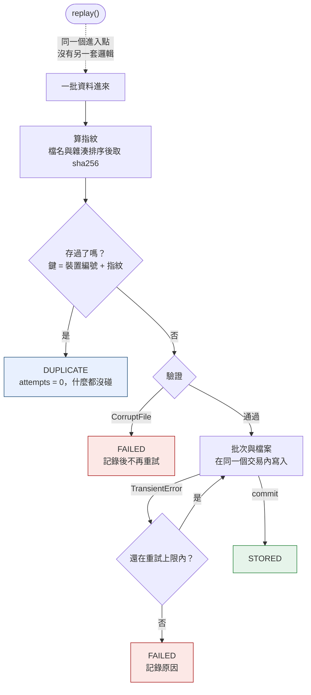
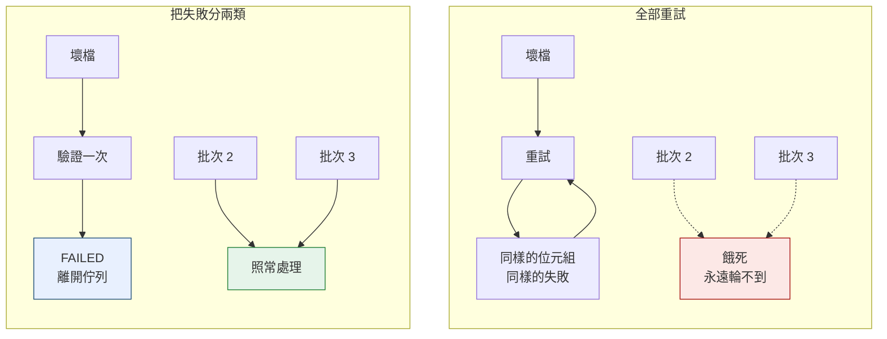

*[English](design.md) ｜ 繁體中文*

# 設計說明

README 主張的兩個決策，各配一張圖。

---

## 1. 去重鍵，以及為什麼恢復不是另一條路徑

一批資料進來，第一件事就是算指紋。如果這個裝置的這個指紋已經出現過，整條寫入路徑直接跳過——沒有 I/O、沒有交易、`attempts == 0`。

`replay()` 沒有自己的邏輯，它重新走進同一條流程。這就是為什麼恢復路徑不會腐爛：**它就是每天在跑的那條**。

圖裡藏了兩個細節：

- **指紋在計算前會先依檔名排序**，所以上傳順序不會改變指紋。重試經常會改變檔案送達的順序。
- **鍵是「裝置 + 內容」，不是只有內容。** 兩台機器可能合法地產生位元組完全相同的讀數，兩筆都必須保留。

---

## 2. 為什麼確定性失敗永遠不重試

重試一個不可能成功的失敗，是一條進料佇列死掉的典型方式：毒訊息永遠回來，把後面排隊的東西全部餓死。

分類刻意只有兩個成員：

| | 重試能改變結果嗎？ | 做法 |
|---|---|---|
| `CorruptFile` | 不能，位元組就是那些位元組 | 記錄後停止，只試一次 |
| `TransientError` | 能，只是當下環境忙碌 | 有上限地重試 |

是哪個剖析器壞了、哪個 socket 逾時，那是日誌的細節。它不是重試決策的輸入，所以不該有自己的例外類別。

驗證排在寫入**之前**，所以已知的壞批次根本進不了重試迴圈。那個順序本身就是整個機制。

---

## 圖上的每個點對應哪個測試

| 圖上的元素 | 測試 |
|---|---|
| `DUPLICATE` 且 `attempts = 0` | `test_duplicate_does_no_work` |
| 指紋不受檔案順序影響 | `test_file_order_does_not_change_fingerprint` |
| 鍵是「裝置 + 內容」 | `test_same_content_from_two_devices_is_two_batches` |
| `CorruptFile` 只被試一次 | `test_corrupt_batch_is_tried_exactly_once` |
| `TransientError` 重試後成功 | `test_transient_failure_is_retried_then_succeeds` |
| 單一交易，全有或全無 | `test_abort_midway_through_a_batch_writes_nothing` |
| `replay()` 走同一條流程 | `test_a_failed_batch_can_be_replayed_successfully` |
